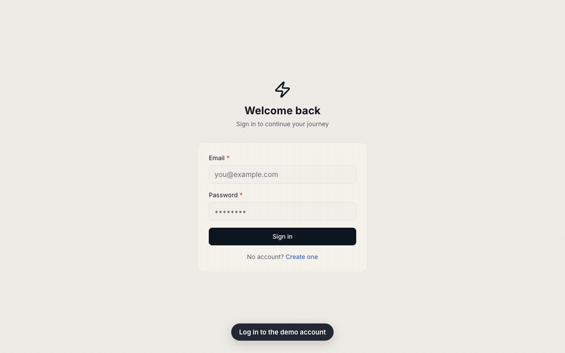
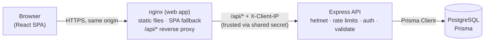

# QuestLog

[](https://github.com/Prabh54/questlog/actions/workflows/ci.yml)

A gamified habit tracker. Turn daily routines into quests, earn XP, level up, build streaks, and watch a year-long consistency heatmap fill in. Full-stack TypeScript (React · Express · PostgreSQL), deployed on Fly.io.

**[Live demo](https://questlog-web.fly.dev)** (log in with `demo@questlog.app` / `questdemo123`) · **[API docs](https://questlog-api-snowy-seastar-7669.fly.dev/docs)** · **[Performance write-up](docs/performance.md)**



## Highlights

- **14× throughput from profiling, not guessing.** I load-tested with k6 on 1.3M completions against a 1-vCPU API and found Node, not Postgres, was the bottleneck. Moving analytics into SQL (window-function streaks, index-only scans) took heavy users from **18 → 252 req/s** and dashboard **p95 from 8.3 s → 0.38 s**. Differential tests across 7 timezones prove the SQL matches the original logic, and they caught a Postgres/Node timezone-data mismatch. [Details →](docs/performance.md)
- **Auth built to survive token theft.** 15-minute in-memory access tokens. Rotating, hashed refresh tokens in `HttpOnly; SameSite=Strict` cookies, with **reuse detection** that revokes the session; it's race-safe under concurrent refreshes. Per-IP and per-account rate limits. [Design →](#authentication)
- **One API contract.** Shared Zod schemas validate requests, type the React client and **generate the OpenAPI docs**. Contract tests check all 27 endpoints against them. [How →](#architecture)
- **Correct under concurrency.** Completing a quest is race-safe: a unique `(quest, period)` index means 5 parallel requests produce exactly one completion.
- **142 automated tests** (Jest + Supertest against real Postgres, Vitest + React Testing Library), with ~90% backend coverage, in a 3-job GitHub Actions pipeline.

---

## Stack

| Layer | Tech |
|---|---|
| Frontend | React 18, Vite, TypeScript, Tailwind CSS, TanStack Query, react-hook-form, Zod |
| Backend | Node 20, Express, TypeScript, Prisma ORM, Zod validators |
| Database | PostgreSQL 16 |
| Auth | 15-min JWT access tokens (memory only) + rotating refresh tokens in HttpOnly cookies with reuse detection; bcrypt; rate limiting; helmet |
| Shared | `@questlog/shared` workspace — Zod schemas for requests *and* responses, built as ESM + CJS with tsup |
| API docs | OpenAPI 3 generated from those schemas (`@asteasolutions/zod-to-openapi`), Swagger UI at `/docs` |
| Infra | Docker, Fly.io (3 apps: web + api + managed Postgres) |
| CI | GitHub Actions — lint, typecheck, unit + integration tests |

## Architecture



**Request flow:** the browser only ever talks to the web app's origin. nginx serves the SPA and proxies `/api/*` to the API, adding the visitor's IP for rate limiting. The API checks the `Authorization: Bearer` access token, validates the body and query with a shared Zod schema, enforces that the user owns the row (404 otherwise, never 403), then calls a service that uses Prisma.

## Authentication

| | Access token | Refresh token |
|---|---|---|
| Format | JWT (HS256, `iss`/`aud`/`sub`/`sid` claims, algorithm pinned) | 256-bit random, opaque |
| Lifetime | 15 minutes | 7 days idle, 30 days absolute per session |
| Lives in | JavaScript memory only, never `localStorage` | `HttpOnly; Secure; SameSite=Strict; __Host-` cookie |
| Stored server-side | no (stateless) | SHA-256 hash only |

- **Rotation with reuse detection.** Every `/auth/refresh` marks the presented token used and issues a new one in the same session. If a used token is ever presented again, someone has a copy of it, so the whole session is revoked. The claim is a single conditional `UPDATE`, so 5 parallel refreshes with one token give exactly one success (tested).
- **Real logout.** `/auth/logout` revokes the session behind the cookie, and `/auth/logout-all` revokes every session ("Sign out of all devices" on the profile page). Access tokens are stateless, so revocation takes effect within at most 15 minutes, at the next refresh.
- **Same-origin by design.** The API is reached through the web app's `/api` proxy, so the refresh cookie is first-party and can be `SameSite=Strict` (no Safari third-party-cookie breakage). `/auth/refresh` and `/auth/logout` also reject requests whose `Origin` isn't the web app (CSRF defence in depth).
- **Client.** On a 401, the client refreshes once and retries. Concurrent requests share one refresh, and the Web Locks API serialises refreshes across tabs, so a legitimate client never trips reuse detection. Logging out in one tab logs out the others (BroadcastChannel).
- **Rate limits** (`express-rate-limit`): login is limited to 20 attempts per IP and 5 failed attempts per account per 15 minutes, sign-up to 10 per IP per hour. All return `429` with `Retry-After`. The client IP comes from Fly's edge, or from nginx when the shared `PROXY_SECRET` matches. Client-supplied headers are never trusted.

**The API contract lives in one place.** `@questlog/shared` holds a Zod schema for every request body, query string and response:

- the API's `validate()` middleware parses bodies and query strings with them (bad input → `400 VALIDATION_FAILED` with per-field errors);
- the web app's forms use the same rules (extended only with UI concerns like "confirm password"), and its API client is typed from the inferred response types;
- the OpenAPI document at [`/docs`](https://questlog-api-snowy-seastar-7669.fly.dev/docs) and [`docs/openapi.json`](docs/openapi.json) is generated from them;
- **contract tests** call all 27 endpoints against a real Postgres and parse every response with its documented schema (response schemas are `.strict()`, so a missing *or* extra field fails), assert that every documented operation was exercised, and assert that Express and the document list exactly the same routes. CI also fails if `docs/openapi.json` is stale.

## Features

- **Quests** — create daily / weekly / monthly / one-time goals, assign categories, set difficulty (Easy → Legendary) and XP reward (5–100).
- **XP + levels** — completions award XP; reaching level *n* takes `50·n·(n−1)` total XP, so `level = floor((1 + √(1 + xp/12.5)) / 2)`. XP is never stored — it's summed from the completion log.
- **Streaks** — current and best per-quest, computed from the entries log.
- **Dashboard** — today's quests, XP progress bar, 30-day completion chart, 365-day consistency heatmap, recent activity feed, top-line stats.
- **Quest detail** — current and best streak, total completions, per-quest heatmap, completion history with undo.
- **Analytics** — completion trend, XP over time, category breakdown, top streaks.
- **Sessions** — "Sign out of all devices" on the profile page.
- **History** — paginated entries with cursor-based pagination.
- **Fast at scale:** analytics are computed in Postgres with index-only scans. On a 1.3M-completion dataset, with 20 concurrent users on a 1-vCPU API, throughput went from 18 to 252 req/s for heavy users and dashboard p95 from 8.3 s to 0.38 s. See [docs/performance.md](docs/performance.md) for the method, profiling, results and the bugs found along the way.
- **27 REST endpoints** across auth, quests, categories, entries, dashboard, analytics — browse them at `/docs`.

## Local development

```bash
# clone & start the dev stack (Postgres + API + Vite, all hot-reloaded)
git clone https://github.com/Prabh54/questlog.git
cd questlog
docker compose -f docker-compose.dev.yml up
```

Then open http://localhost:5173 and register an account. First boot is slow (~60s while each container runs `npm ci`); restarts are fast, because dependencies are cached in named volumes and reinstalled only when `package-lock.json` changes.

### Seed demo data

```bash
cd backend
npm install
npx prisma generate
npm run db:seed-demo
```

Creates (or resets) `demo@questlog.app` / `questdemo123` with 4 categories, 8 quests and **a year** of realistic completions: streaks, an abandoned quest, weekly cadences, and an improving habit (~1,500 entries, level 25). Set `DEMO_HISTORY_DAYS` to change the length. The demo GIF above was recorded against this data.

For load testing there is a separate 1.3M-row dataset in [`bench/`](bench).

### Run tests

Build the shared contract package once first (`npm run dev -w @questlog/shared` rebuilds it on change):

```bash
npm run build --workspace=@questlog/shared
npm run --workspace=@questlog/backend test
npm run --workspace=@questlog/frontend test
```

After changing a schema or route, regenerate the API spec: `npm run openapi --workspace=@questlog/backend`.

## Environment variables

### Backend (`backend/.env`)

| Var | Required | Default | Notes |
|---|---|---|---|
| `DATABASE_URL` | yes | — | `postgres://` or `postgresql://` URL |
| `JWT_SECRET` | yes | — | ≥ 32 characters |
| `PORT` | no | `3001` | |
| `NODE_ENV` | no | `development` | `development` \| `production` \| `test` |
| `CORS_ORIGIN` | no | `http://localhost:5173` | comma-separated list; also the allowed `Origin`s for `/auth/refresh` and `/auth/logout` |
| `PROXY_SECRET` | no | — | ≥ 32 chars; must match the web app's. Lets the API trust the visitor IP that nginx forwards |

Validated at boot via Zod ([`backend/src/config/env.ts`](backend/src/config/env.ts)) — the server refuses to start with a bad config.

### Frontend (`frontend/.env`, baked in at build time)

| Var | Required | Default | Notes |
|---|---|---|---|
| `VITE_API_URL` | no | `/api` | Leave unset: the API is reached same-origin through the Vite (dev) or nginx (prod) proxy |
| `API_PROXY_TARGET` | no | `http://localhost:3001` | Dev only: where Vite proxies `/api` |

The production web container's nginx reads `API_UPSTREAM` (the API's URL) and `PROXY_SECRET` at startup.

## Project layout

```
questlog/
├── backend/        Express API
│   ├── prisma/     schema, migrations, seed
│   └── src/        controllers · services · routes · middleware · validators
├── frontend/       React app
│   └── src/        features · components · services · lib · pages
├── shared/         @questlog/shared — the API contract (Zod schemas + inferred types)
├── bench/          load test: 1.3M-row seed, k6 scenarios, report script
├── docs/           openapi.json (generated) · performance.md · demo video
├── docker-compose.dev.yml
├── fly.backend.toml
└── fly.frontend.toml
```

## Deployment

Both apps deploy to Fly.io:

```bash
flyctl deploy --config fly.backend.toml
flyctl deploy --config fly.frontend.toml
```

One-time setup: give both apps the same proxy secret, and make sure the API allows the web origin:

```bash
SECRET=$(openssl rand -hex 32)
flyctl secrets set PROXY_SECRET=$SECRET --app questlog-api-snowy-seastar-7669 --stage
flyctl secrets set PROXY_SECRET=$SECRET --app questlog-web --stage
flyctl secrets set CORS_ORIGIN=https://questlog-web.fly.dev --app questlog-api-snowy-seastar-7669 --stage
```

Deploy the API first (it runs migrations on boot), then the web app. The web app's nginx proxies `/api/*` to `API_UPSTREAM` from [`fly.frontend.toml`](fly.frontend.toml).

## CI

GitHub Actions ([`.github/workflows/ci.yml`](.github/workflows/ci.yml)) runs on every push:

- Lint (ESLint) — backend, frontend
- Typecheck (`tsc --noEmit`) — backend, frontend, shared; build of the shared package (ESM + CJS + types)
- OpenAPI drift check — regenerates `docs/openapi.json` and fails if it changed
- Unit tests (Jest) — streak, XP and cursor logic
- Integration + contract tests (Jest + supertest + real Postgres) — every endpoint, concurrency, ownership isolation
- Component tests (Vitest + React Testing Library) — frontend

## License

MIT
